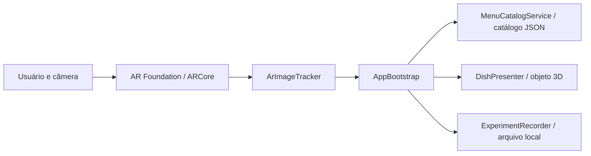

# DegustAR — Cardápio RA

Aplicativo Android em Unity que associa etiquetas de pratos a representações 3D e informações de cardápio. O protótipo também oferece simulação no editor e questionário de usabilidade SUS.

## Contexto e objetivo

Clientes de estabelecimentos podem ter dificuldade para imaginar um prato e consultar suas informações antes de escolhê-lo. O DegustAR propõe apresentar uma representação tridimensional e dados nutricionais ao reconhecer a etiqueta correspondente. O público-alvo são pessoas consultando um cardápio em um dispositivo móvel; a experiência depende de câmera e de etiquetas cadastradas.

O objetivo geral é desenvolver um protótipo de cardápio com realidade aumentada. Entre os objetivos técnicos estão reconhecer imagens, associá-las ao catálogo, apresentar um objeto 3D e dados do prato e registrar respostas de usabilidade.

## Identificação acadêmica

Disciplina: UPX — Realidade Aumentada. A equipe deve acrescentar nome da equipe, integrantes, RAs, responsabilidades reais, curso, professor e semestre; essas informações não foram encontradas no projeto.

## Funcionalidades

| ID | Funcionalidade | Situação no código |
|---|---|---|
| RF01 | Reconhecimento de imagem e associação ao prato | 🚧 Implementação presente; depende de imagens de referência e teste em dispositivo |
| RF02 | Apresentação 3D do prato | 🚧 Usa objetos geométricos temporários quando não há modelo próprio |
| RF03 | Exibição de preço, descrição, nutrientes e alergênicos | ✅ Implementada no código |
| RF04 | Simulação de seleção de pratos | ✅ Implementada no código |
| RF05 | Questionário SUS e registro de eventos | ✅ Implementada no código |

A presença no código não comprova execução ou teste em aparelho. Os dados do catálogo são de demonstração e precisam ser validados antes de uso real.

## Tecnologias e dependências

| Tecnologia | Versão | Finalidade |
|---|---|---|
| Unity | 6000.4.5f1 | Editor e motor da aplicação |
| C# | definida pelo Unity | Lógica da aplicação |
| AR Foundation | 6.4.1 | Rastreamento de imagens |
| ARCore XR Plugin | 6.4.1 | Suporte de RA no Android |
| XR Plugin Management | 4.5.0 | Gerenciamento de provedores XR |
| Unity Test Framework | 1.6.0 | Testes automatizados |

Os pacotes estão declarados em `Packages/manifest.json` e são restaurados pelo Unity Package Manager. O projeto requer Android Build Support e aparelho Android compatível com ARCore para RA real.

## Arquitetura e realidade aumentada



A abordagem é **image tracking**. O `ARTrackedImageManager` comunica imagens adicionadas ou atualizadas; `ArImageTracker` publica o nome e o transform quando o estado é `Tracking`. `AppBootstrap` consulta o catálogo pelo identificador da imagem e solicita ao apresentador a exibição do prato junto ao transform detectado. A biblioteca de imagens precisa ser configurada antes do teste real. A simulação seleciona pratos por botões e não comprova o rastreamento pela câmera.

## Estrutura e componentes

- `Assets/App/Runtime/`: lógica da aplicação.
- `Assets/App/Editor/`: gerador do projeto MVP no editor.
- `Assets/App/Resources/menu_catalog.json`: pratos, marcadores e dados nutricionais.
- `Assets/App/Tests/EditMode/`: testes do cálculo SUS.
- `Packages/` e `ProjectSettings/`: dependências e configuração Unity.

| Componente | Responsabilidade |
|---|---|
| `AppBootstrap` | Coordena interface, seleção, questionário e eventos |
| `ArImageTracker` | Encaminha imagens rastreadas |
| `MenuCatalogService` e `MenuModels` | Carregam e representam o catálogo |
| `DishPresenter` | Apresenta a representação do prato |
| `SusCalculator` | Calcula a pontuação SUS |
| `ExperimentRecorder` | Registra eventos localmente |
| `MvpProjectGenerator` | Prepara os recursos e a cena MVP no editor |

## Configuração e execução

1. Instale o Unity Hub e o Unity **6000.4.5f1**, incluindo Android Build Support.
2. Clone o repositório e abra a pasta pelo Unity Hub:

   ```bash
   git clone https://github.com/hrqric/DesgutAR.git
   ```

3. Aguarde a importação e a restauração dos pacotes. No editor, escolha **Cardapio RA > Preparar projeto MVP**.
4. Abra `Assets/Scenes/Mvp.unity` e pressione Play. Use os botões de simulação para selecionar os pratos.
5. Para RA real, importe as imagens das etiquetas e adicione-as a `Assets/App/Resources/MenuReferenceImages.asset`, com os nomes `marker_prato_001`, `marker_prato_002` e `marker_prato_003`. Informe a largura física de cada imagem em metros.
6. Selecione Android nas configurações de build, gere e instale o aplicativo em dispositivo compatível com ARCore e conceda acesso à câmera quando solicitado.

Para substituir as geometrias temporárias, adicione prefabs em `Assets/App/Resources/Models` com os nomes correspondentes a `modelResource` no catálogo.

## Como utilizar

Na simulação, selecione um prato na lista para consultar sua representação e informações. No dispositivo configurado para RA, aponte a câmera para uma etiqueta cadastrada e aguarde o reconhecimento. Para avaliar a interface, selecione **Responder questionário SUS** e responda às dez questões.

## Dados e requisitos não funcionais

Os eventos são gravados em `Application.persistentDataPath/experiment-events.jsonl`, incluindo identificador de sessão e eventos de interação. O README original informa que nomes, e-mails e dados de saúde não são coletados. A execução de RA depende de câmera, compatibilidade com ARCore e imagens de referência configuradas; as condições de desempenho e compatibilidade precisam de validação em aparelhos reais.

## Testes e limitações

Existe teste automatizado de cálculo SUS em `Assets/App/Tests/EditMode/SusCalculatorTests.cs`. Execute-o no Unity Test Runner, em Edit Mode. Não há resultado de execução ou registro de testes em dispositivo confirmado nesta documentação.

Os modelos são temporários, as etiquetas precisam ser cadastradas e a compatibilidade, o rastreamento e o desempenho em aparelhos reais ainda precisam ser comprovados. Não há dispositivos testados identificados nos arquivos examinados.

## Pendências para entrega

- Registrar testes efetivamente realizados, procedimentos, resultados e modelos e versões dos aparelhos.
- Adicionar capturas atuais das telas e ao menos uma evidência visual da solução funcionando em `docs/images/`.
- Acrescentar dados acadêmicos e responsabilidades reais da equipe, cronograma e problemas técnicos com causas e soluções confirmadas.
- Verificar a execução do projeto, a configuração do rastreamento, o histórico de commits e a ausência de informações sensíveis antes da entrega.
